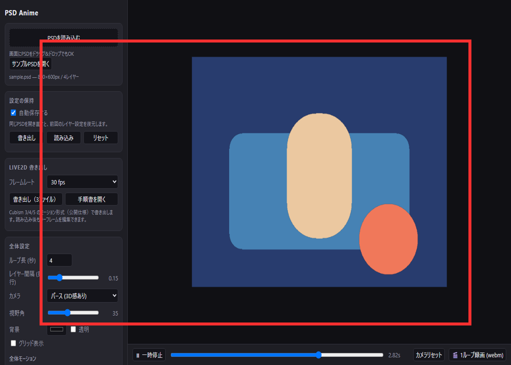

# ScreenFrame - 画面枠表示アプリ

画面の上に、指定した範囲を囲む枠を表示する Windows 用の常駐アプリです。
配信や画面録画で「ここが映る範囲」を確認・強調するのに使えます。枠はクリックを邪魔しません。



## 主な機能

- **常に最前面の枠**: 透明なオーバーレイで、指定範囲を色付きの枠で囲みます
- **クリックスルー**: 通常時は枠をクリックしても下のウィンドウに届きます
- **設定モード**: 枠をドラッグで移動、四隅・各辺のハンドルでリサイズ
- **右クリックメニュー**: 枠の色（プリセット9色・RGB 指定）、太さ（1〜10px）、プリセットサイズ（720p / 1080p / 4:3 / 16:9）
- **タスクトレイ常駐**: 設定モードの切り替え、枠の表示/非表示、終了
- **自動保存**: 位置・サイズ・色・太さを `%AppData%\ScreenFrame\settings.json` に保存し、次回起動時に復元

## ダウンロード

[Releases](https://github.com/tomozow/ScreenFrame/releases) から zip をダウンロードして展開し、`ScreenFrame.exe` を実行します。
動作には [.NET 6 デスクトップ ランタイム](https://dotnet.microsoft.com/download/dotnet/6.0)（Windows 10/11）が必要です。

## 使い方

1. `ScreenFrame.exe` を起動すると、枠が画面に表示され、タスクトレイにアイコンが出ます
   （Windows 11 ではタスクバーの「^」の中に隠れていることがあります）
2. タスクトレイのアイコンをダブルクリック（または右クリック →「設定モードON/OFF」）で設定モードに入ります
3. 設定モードでは次の操作ができます
   - 枠の内側をドラッグ: 移動
   - 白いハンドルをドラッグ: リサイズ
   - 右クリック: 色・太さ・プリセットサイズの変更
4. **Esc** キーまたはトレイアイコンのダブルクリックで設定モードを終了し、クリックスルーに戻ります
5. 終了はタスクトレイのアイコンを右クリック →「終了」

## ビルド

.NET 6.0 SDK 以上が必要です。

```bash
git clone https://github.com/tomozow/ScreenFrame.git
cd ScreenFrame
dotnet run
```

配布用ビルド:

```bash
dotnet publish -c Release -r win-x64 --self-contained false -o release
```
